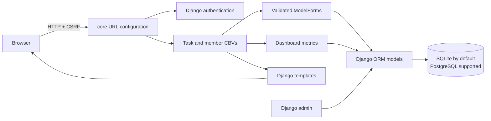
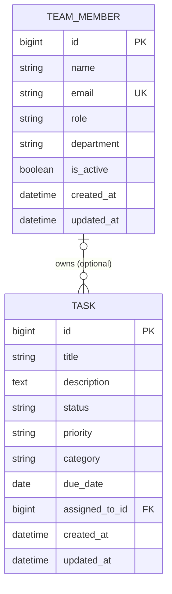

# GENTROBYTE Task & Resource Manager

A server-rendered Django demo for small-team managers coordinating tasks, owners, and due dates. It includes authenticated CRUD workflows for tasks and team members, a searchable run sheet, status and priority filters, due-date views, pagination, Django admin, and synthetic records for a populated first run.

> **Demo scope:** Seeded names and tasks are illustrative. This project has sign-in but does not include public registration, role-based permissions, or organization-level tenancy. Do not expose it to the public internet without adding the access and deployment controls your environment requires.

## Architecture

The app uses Django's built-in class-based views and authentication. Views handle HTTP concerns, ModelForms validate submitted data, a small service module computes dashboard summaries, and templates render the response with Django's auto-escaping enabled.



### Data model



Deleting a person with task history is blocked; deactivate that person instead. Deleting a task is allowed after a dedicated confirmation page. The nullable task assignment uses `SET_NULL`, so a person without task history can be removed without deleting other records.

## Features

- **Task run sheet:** 18 sample tasks, summary counts, due-window filters, search by task/description/category/person, status and priority filters, sortable title/date columns, and pagination.
- **People directory:** Separate team-member records with searchable, filterable activity status and task counts.
- **Full CRUD:** Task and team-member create, detail, update, and confirmed-delete flows with server-side validation and success/error messages.
- **Authentication:** All task and people pages require a Django account. Local development has a seeded, non-admin demo account; there is no public registration.
- **Admin:** Searchable, filterable Task and TeamMember records at `/admin/`.
- **Security basics:** CSRF middleware and tokens on state-changing forms, Django template auto-escaping, bounded sort choices, secure session settings, and production-only secure cookies.
- **Responsive interface:** Django Templates, Tailwind CSS CDN, Alpine.js for the mobile menu, and Inter typography. The CDN assets require an internet connection in the browser.

## Setup (Windows PowerShell)

Python 3.14 is recommended for the current Django 6.1 release. From the repository root:

```powershell
py -3.14 -m venv .venv
.\.venv\Scripts\Activate.ps1
python -m pip install --upgrade pip
python -m pip install -r requirements.txt
python manage.py migrate
python manage.py seed_data
python manage.py runserver
```

Open [http://127.0.0.1:8000/](http://127.0.0.1:8000/) and use the local demo credentials:

| Username | Password |
|---|---|
| `demo` | `GentrobyteDemo!2026` |

The sign-in page also displays these credentials when `DEBUG=true`. `seed_data` creates the non-admin demo account if it is missing, along with illustrative records; it never resets the password of an existing account. You can override the local demo username or password with `DEMO_ACCOUNT_USERNAME` or `DEMO_ACCOUNT_PASSWORD` before running `seed_data`. Use `createsuperuser` separately if you need Django admin access.

If PowerShell prevents venv activation, run commands directly with `.\.venv\Scripts\python.exe`.

> **Local demo credentials:** These public sample credentials are only for local development. `seed_data` does not create the demo account when `DJANGO_DEBUG=false`. Never expose the local demo account or its default password on a public deployment; set a private password or remove the account before hosting.

## Configuration

Settings read environment variables; the project does not load a `.env` file:

| Variable | Default | Purpose |
|---|---|---|
| `DJANGO_SECRET_KEY` | Development-only placeholder | Required when `DJANGO_DEBUG=false`; use a long random secret outside local development. |
| `DJANGO_DEBUG` | `true` | Set to `false` for non-debug operation. |
| `DJANGO_ALLOWED_HOSTS` | `localhost,127.0.0.1` | Comma-separated allowed hostnames. |
| `DJANGO_SECURE_SSL_REDIRECT` | `true` in non-debug mode | Redirect HTTP to HTTPS outside local development. |
| `DJANGO_SECURE_HSTS_SECONDS` | `31536000` in non-debug mode | HSTS duration in seconds; verify your HTTPS deployment before enabling. |
| `DJANGO_SECURE_HSTS_INCLUDE_SUBDOMAINS` | `false` | Enable only when every subdomain is HTTPS-only. |
| `DJANGO_SECURE_HSTS_PRELOAD` | `false` | Enable only after confirming the domain meets browser preload requirements. |
| `DB_ENGINE` | `django.db.backends.sqlite3` | Set to `django.db.backends.postgresql` to use PostgreSQL. |
| `DB_NAME`, `DB_USER` | Required for PostgreSQL | Database name and user. |
| `DB_PASSWORD`, `DB_HOST`, `DB_PORT` | Empty, `localhost`, and `5432` | Optional password and connection location; the `psycopg` driver is included. |

Example PostgreSQL configuration in PowerShell:

```powershell
$env:DB_ENGINE = "django.db.backends.postgresql"
$env:DB_NAME = "gentrobyte"
$env:DB_USER = "app_user"
$env:DB_PASSWORD = "use-a-secret-from-your-environment"
$env:DB_HOST = "127.0.0.1"
$env:DB_PORT = "5432"
python manage.py migrate
```

When deploying, supply a real secret, configure allowed hosts and HTTPS, and review Django's deployment checklist. This demo intentionally has no account registration, tenant isolation, or permission roles.

## Verification

Run the complete test suite:

```powershell
python manage.py test
```

The tests cover model and form validation, sign-in and sign-out, authentication gates, CSRF enforcement, task CRUD, member CRUD and deletion safeguards, search/filter behavior, and pagination. Check configuration and migration drift with:

```powershell
python manage.py check
python manage.py makemigrations --check --dry-run
```
